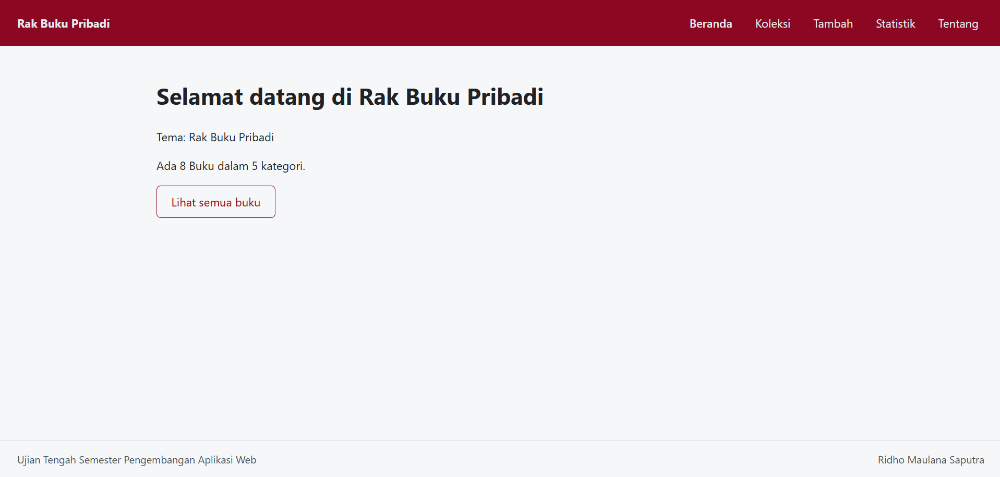
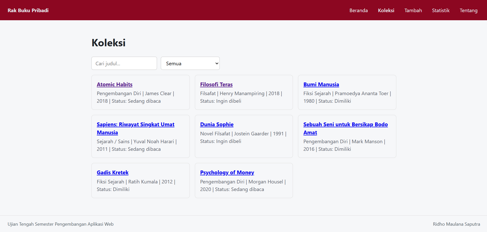
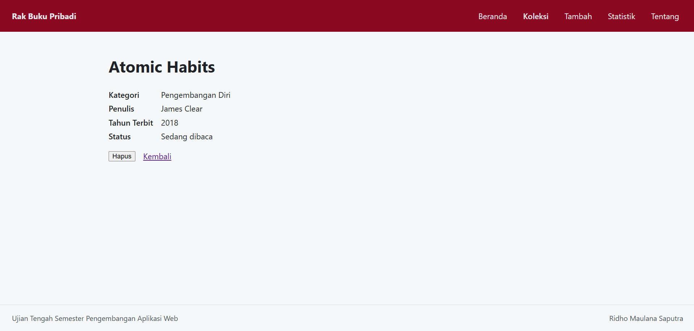
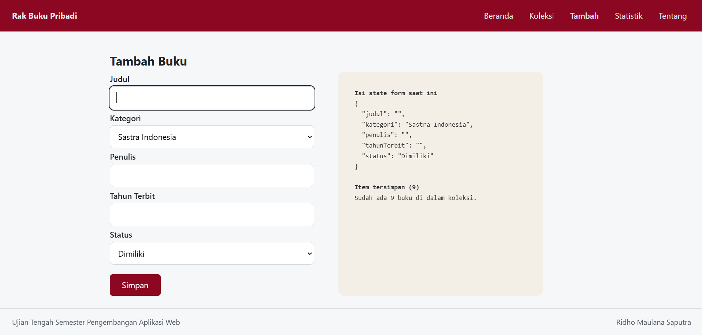
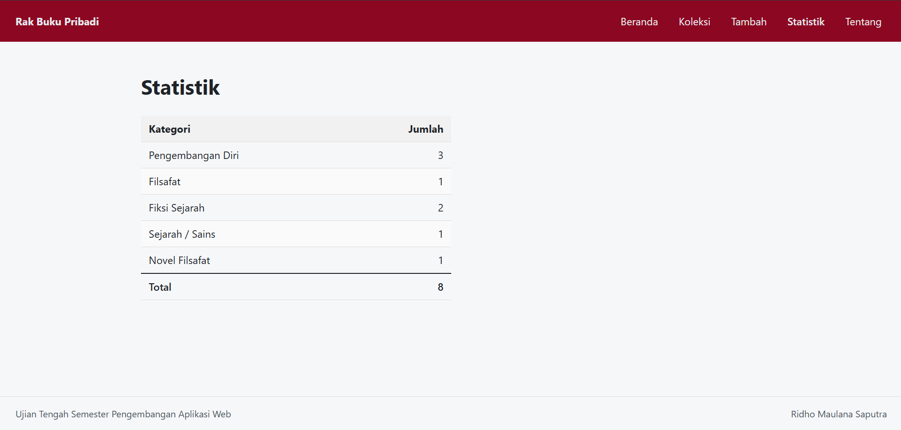
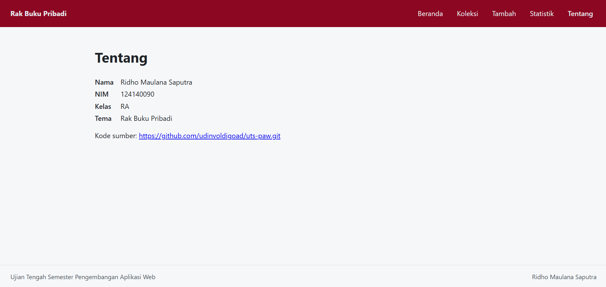

# Ujian Tengah Semester IF25-22014 Pengembangan Aplikasi Web


# Rak Buku Pribadi

| Informasi | Detail |
| :--- | :--- |
| **Nama** | Ridho Maulana Saputra |
| **NIM** | 124140090 |
| **Kelas** | RA |
| **Tema** | Rak Buku Pribadi |
| **Deployment** | https://udinvoldigoad.github.io/uts-paw/ |

---

## Tangkapan Layar Aplikasi

| Halaman Beranda | Halaman Koleksi |
| :---: | :---: |
|  |  |
| *Gambar 1. Halaman Beranda* | *Gambar 2. Halaman Koleksi Buku* |

| Halaman Detail Buku | Halaman Tambah Buku |
| :---: | :---: |
|  |  |
| *Gambar 3. Halaman Detail Buku* | *Gambar 4. Halaman Form Tambah Buku* |

| Halaman Statistik | Halaman Tentang |
| :---: | :---: |
|  |  |
| *Gambar 5. Halaman Statistik Koleksi* | *Gambar 6. Halaman Tentang Aplikasi* |

---

## Fitur

- Menampilkan ringkasan dan daftar koleksi buku pribadi.
- Pencarian dan filter buku berdasarkan kategori.
- Melihat informasi lengkap buku pada halaman detail.
- Menambahkan buku baru ke dalam koleksi.
- Menampilkan statistik jumlah koleksi buku berdasarkan kategori.
- Menampilkan identitas mahasiswa, tema, dan juga link repo github di halaman tentang.

---

## Menjalankan secara lokal

```bash
cd app
npm install
npm run dev
```

---

## Konsep React yang dipakai

- Components & Props: Memecah antarmuka menjadi komponen modular yang dapat digunakan kembali.
- State Management (useState): Mengelola state lokal pada form input, validasi, dan filter pencarian.
- React Context (useContext & Custom Hook useKoleksi): Mengelola data koleksi buku secara global di seluruh halaman.
- React Router (react-router-dom): Navigasi multi-page (SPA) menggunakan useNavigate, useParams, dan <Link>.
